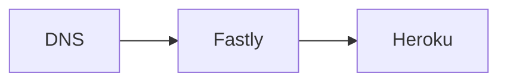
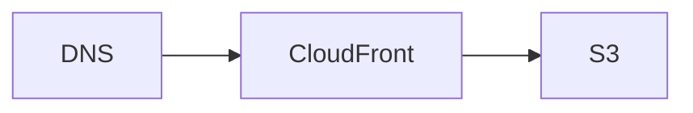
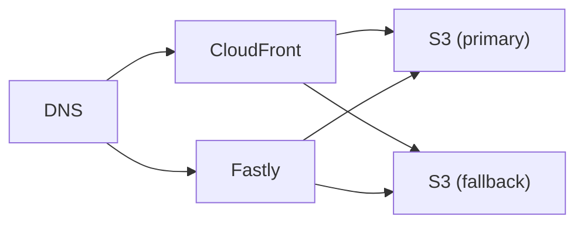

# `crates-io`

This is the [Terraform] module that defines the infrastructure for [crates.io].

[crates.io] consists of a few different components:

  - A web application hosted on [Heroku](https://heroku.com/) (`crates.io`)
  - Static crates stored in S3 (`static.crates.io`)
  - HTTP index stored in S3 (`index.crates.io`)

These are documented in more detail in the following sections.

## Web Application



The user-facing web application for [crates.io] is hosted on Heroku and is not
managed with [Terraform]. The module configures Fastly as the normal CDN path,
including its Next-Gen WAF, and retains CloudFront as an alternative path.

In production, the CloudFront distribution is disabled, and the direct `cloudfront-app.crates.io` hostname is not
published. Set `webapp_cloudfront_enabled` to enable the distribution and
publish its direct hostname, then set `webapp_cloudfront_weight` to a positive
value to route traffic to it.
In staging, CloudFront remains enabled and is available at
`cloudfront-app.staging.crates.io` for direct testing, even if its DNS traffic
weight is zero.

### Fastly API rate limits

Fastly NGWAF applies a per-IP limit of 600 requests per 10 minutes to normal
requests. Requests with an `X-Docsrs-Authorization` header matching
`docsrs_authorization_token` are excluded from that limit and have a separate
shared limit of 10,000 requests per minute across all docs.rs instances. The
shared token header is the rate-limit client key. Both limits block for five
minutes and return HTTP 429 when exceeded.

Before applying this module, create a `SecureString` SSM parameter at
`/${env}/crates-io/webapp/docsrs-auth-token` in the crates.io WAF account. Set
its value to the same token stored at `/docs-rs/registry-api-token` in the
matching docs.rs account. Terraform reads the parameter; it does not manage its
value. Terraform state contains the decrypted value in the data source and
Fastly rules, so protect state access accordingly.

### CDN origin authentication

CloudFront and Fastly send `X-Crates-Origin-Auth` on requests to the Heroku
origin over HTTPS, overwriting any client-supplied value. Both read the token
from the SSM `SecureString` `/${env}/crates-io/webapp/origin-auth-token`.

The tokens (one for staging and one for production) were generated with:

```shell
openssl rand -hex 32
```

Heroku has the same token stored in the Config Vars as `CRATES_ORIGIN_AUTH_TOKEN`.

## `index.crates.io`



From an infrastructure perspective, `index.crates.io` is a simple S3 bucket with
CloudFront in front of it.

## `static.crates.io`



`static.crates.io` serves the static crates to users. The crates are stored in
two different S3 buckets that are geographically distributed for disaster
resilience. Traffic is routed through one of two CDNs, either CloudFront or
Fastly, using [load-balancing at the DNS level][weighted-routing].

### Fastly

We use Fastly's [Compute@Edge] workers to serve the static crates, which mirror
the functionality of the CloudFront distribution. The logic of these workers is
implemented in the [`compute-static`](./compute-static) crate within the
Terraform module.

When applying changes to the infrastructure, an external data source in
Terraform builds the compute function. This ensures that the latest version gets
deployed.

[crates.io]: https://crates.io/
[compute@edge]: https://www.fastly.com/products/edge-compute
[terraform]: https://terraform.io/
[weighted-routing]: https://docs.aws.amazon.com/Route53/latest/DeveloperGuide/routing-policy-weighted.html
