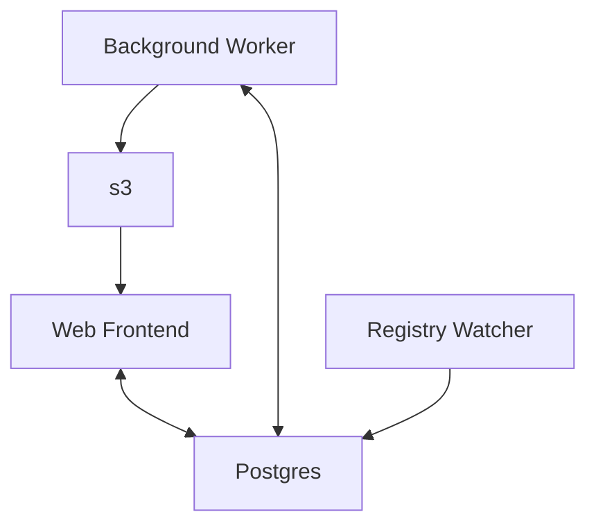
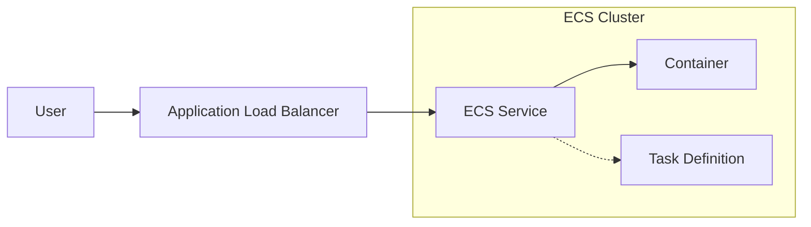

# `docs-rs`

This is the [Terraform] module that defines the infrastructure for [docs.rs].

This module has separate staging and production account configurations. It defines
the new infrastructure; the legacy production deployment is managed separately
under `terraform/docs-rs`. Account configuration alone does not indicate migration
or rollout status.

## Overview

[docs.rs] consists of a few different components:

- A web frontend hosted as a container running in an [ECS] cluster.
- Documentation builders running in Docker on dedicated EC2 hosts in an Auto Scaling group.
- A singleton background registry watcher on ECS which includes:
  - crate registry watcher that watches for changes to the crates registry and enqueues doc builds
  - the repository stats updater that ensures # stars, # issues, etc. from GitHub & GitLab are up-to-date

These are documented in more detail below.

Data is stored in two different locations:

  - Static rendered crate documentation is stored in [S3](https://aws.amazon.com/s3).
  - Other data is stored in a postgresql database [RDS](https://aws.amazon.com/rds) instance.

### The Flow

The registry watcher watches the registry for new entries. When a new crate is added, it adds that crate to a queue stored in the database. The background worker watches the queue and works off crates from the queue as quickly as possible. It builds crate documentation and stores the artifacts in s3, adds relevant information to the database, and removes the crate from the queue. The web frontend then displays that information to the user.

## Web Frontend

The web frontend runs on ECS/Fargate behind an Application Load Balancer, with
DNS records in [Route 53]. This module does not provision a CDN. The web service
currently has one desired task, 0.25 vCPU, 512 MiB memory, and a local archive-index
cache. ALB health checks use `/-/health`. Each task uses PostgreSQL and S3.

The existing service supports multiple tasks by increasing `tasks_count` in
`web-server.tf`; each task gets its own cache and database pool (up to ten
connections). No web autoscaling target or policy is configured.

## Admin task

`docs-rs-admin` is a standalone Fargate task using the CLI image's normal
`tini` + `docs_rs_admin` entrypoint. It has no ECS service or load balancer.
Override the `app` container command when calling `RunTask`, for example
`["database", "migrate"]`. The database URL is injected from SSM and logs are
written to `/ecs/docs-rs-admin`.

`docs-rs-release` derives its configuration from the admin task, sharing its
image, IAM roles, environment, secrets, storage, and CloudWatch log group. It
overrides the entrypoint and command to run the packaged
`/usr/local/bin/docs_rs_release.sh` through `tini` and `/bin/sh`.

After the web service is stable, the docs.rs deployment workflow runs the
release task using the web service's subnets and security groups. The script
applies database migrations, then purges static content if Fastly is configured.
General admin calls continue to use `docs-rs-admin` with command overrides.

Apply this module in the target account before enabling the updated action:
it provisions the admin ECR repository, task definition, and CI permissions.
Deployment workflows serialize runs using GitHub environment concurrency.
Migrations run after the web rollout and must be compatible with that version.

## Background Worker

Builders run on dedicated Ubuntu EC2 instances in an Auto Scaling group with a
Launch Template. Cloud-config installs packages and writes configuration; a
bootstrap script installs gVisor and starts Docker. Systemd runs the builder
container. Terraform owns the image version, host configuration, IAM,
and fleet size. See [builder setup and operations](BUILDERS.md).

## Registry Watcher

`docs-rs-registry-watcher` is a Fargate service with one desired task and no
autoscaling or load balancer. Deployments stop the old task before starting its
replacement (minimum healthy percentage 0, maximum percentage 100), so there is
a brief interruption rather than two watchers running during a rollout. This
does not prevent someone from manually launching an additional standalone task.

The task runs `docs_rs_watcher start`, sharing the database and storage settings
with the other containers. It uses its own database pool (maximum 10 connections),
checks the registry every 30 seconds, and limits queued rebuilds to 200. Its
registry index is stored under `/tmp` on ephemeral task storage and is fetched
again after task replacement. Logs are written to `/ecs/docs-rs-registry-watcher`.
Its security group allows outbound connections and no inbound connections.
Database access and deletion of removed crates' S3 documentation are allowed.

Before the service can start, publish the `registry-watcher` Docker build target
to the `docs-rs-registry-watcher` ECR repository with the `latest` tag. The shared
GitHub deployment role has push/pull and service update permissions. The docs.rs
workflow must publish this image and force a new deployment of this service,
then wait for it to stabilize, after running release migrations. The GitHub
repository updater token is injected from the existing SSM parameter
`/docs-rs/github-access-token`, shared with builders. Rotate the parameter and
restart both workloads to reload a changed token. GitLab tokens and Fastly
configuration are not injected into this task yet.

[terraform]: https://terraform.io
[docs.rs]: https://docs.rs
[ECS]: https://aws.amazon.com/ecs
[Route 53]: https://aws.amazon.com/route53/
