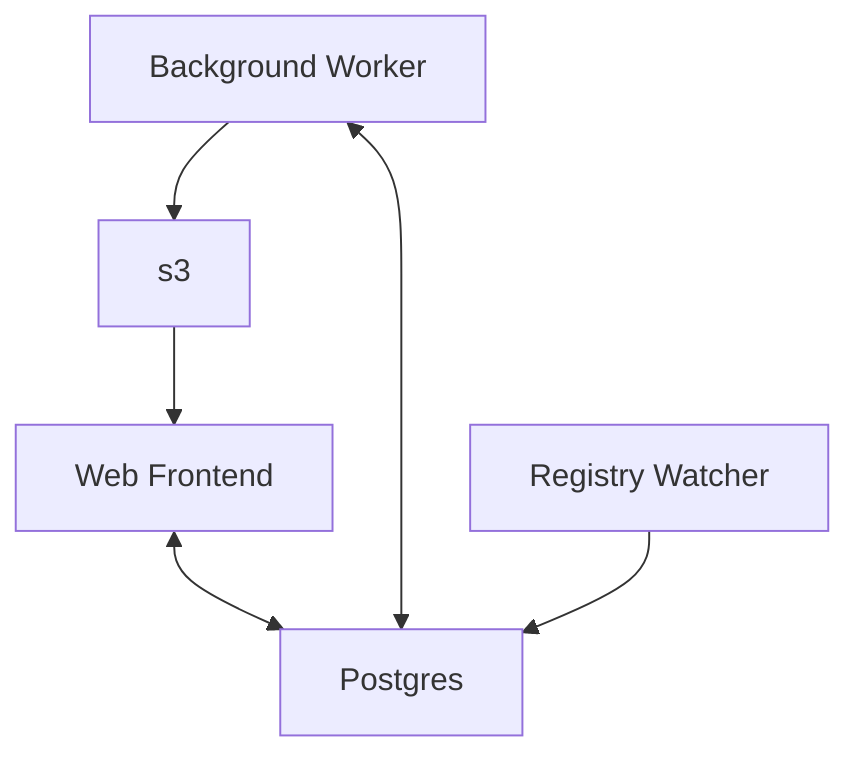
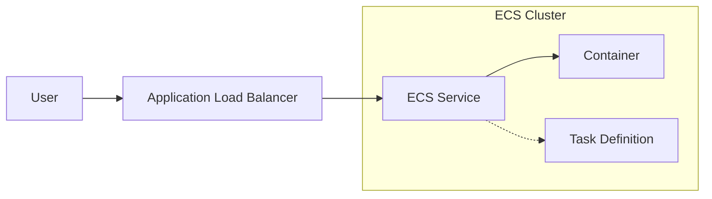

# `docs-rs`

This is the [Terraform] module that defines the infrastructure for [docs.rs].

This module has separate staging and production account configurations. It defines
the new infrastructure; the legacy production deployment is managed separately
under `terraform/docs-rs`. Account configuration alone does not indicate migration
or rollout status.

## Overview

[docs.rs] consists of a few different components:

- A web frontend hosted as a container running in an [ECS] cluster.
- Documentation builders running in Docker on dedicated EC2 hosts in an Auto Scaling group.
- A singleton background registry watcher on ECS which includes:
  - crate registry watcher that watches for changes to the crates registry and enqueues doc builds
  - the repository stats updater that ensures # stars, # issues, etc. from GitHub & GitLab are up-to-date

These are documented in more detail below.

Data is stored in two different locations:

  - Static rendered crate documentation is stored in [S3](https://aws.amazon.com/s3).
  - Other data is stored in a postgresql database [RDS](https://aws.amazon.com/rds) instance.

### The Flow

The registry watcher watches the registry for new entries. When a new crate is added, it adds that crate to a queue stored in the database. The background worker watches the queue and works off crates from the queue as quickly as possible. It builds crate documentation and stores the artifacts in s3, adds relevant information to the database, and removes the crate from the queue. The web frontend then displays that information to the user.

## Web Frontend

The web frontend runs on ECS/Fargate behind an Application Load Balancer, with
DNS records in [Route 53]. This module does not provision a CDN. The web service
has two desired tasks in both environments. Each task has 1 vCPU, 2 GiB memory
including sidecars, and a local archive-index cache. ALB health checks use
`/-/health`. Each task uses PostgreSQL and S3.

Set `web_count` in each environment's Terragrunt inputs to change the desired
number of tasks; each task gets its own cache and database pool (up to ten
connections). No web autoscaling target or policy is configured.

## Shared error reporting

All workloads receive `SENTRY_DSN` from the account-local SecureString parameter
`/docs-rs/sentry-dsn`. Create it with the desired project's DSN before applying
this module. Terraform references the parameter without requesting decryption;
ECS injects the value at task launch and builders fetch it at controller startup.

`sentry_environment` sets `SENTRY_ENVIRONMENT` (`staging` or `prod` in the
account inputs). `sentry_traces_sample_rate` sets `SENTRY_TRACES_SAMPLE_RATE`,
defaults to `0.001`, and must be between 0 and 1. The application explicitly
samples build transactions at 100% regardless of this default rate. Updating
the DSN requires new tasks or a builder restart to reload the value.

## Admin task

`docs-rs-admin` is a standalone Fargate task using the CLI image's normal
`tini` + `docs_rs_admin` entrypoint. It has no ECS service or load balancer.
Override the `app` container command when calling `RunTask`, for example
`["database", "migrate"]`. The database URL is injected from SSM and application
logs are sent to Datadog with `service:docs-rs-admin`.

`docs-rs-release` derives its configuration from the admin task, sharing its
image, IAM roles, environment, secrets, storage, and Datadog sidecars. It
overrides the entrypoint and command to run the packaged
`/usr/local/bin/docs_rs_release.sh` through `tini` and `/bin/sh`.

After the web service is stable, the docs.rs deployment workflow runs the
release task using the web service's subnets and security groups. The script
applies database migrations, then purges static content if Fastly is configured.
General admin calls continue to use `docs-rs-admin` with command overrides.

Apply this module in the target account before enabling the updated action:
it provisions the admin ECR repository, task definition, and CI permissions.
Deployment workflows serialize runs using GitHub environment concurrency.
Migrations run after the web rollout and must be compatible with that version.

## Background Worker

Builders run on dedicated Ubuntu EC2 instances in an Auto Scaling group with a
Launch Template. Cloud-config installs packages and writes configuration; a
bootstrap script installs gVisor and starts Docker. Systemd runs the builder
container. Terraform owns the image version, host configuration, IAM,
and fleet size. See [builder setup and operations](BUILDERS.md).

## Registry Watcher

`docs-rs-registry-watcher` is a Fargate service with one desired task and no
autoscaling or load balancer. Deployments stop the old task before starting its
replacement (minimum healthy percentage 0, maximum percentage 100), so there is
a brief interruption rather than two watchers running during a rollout. This
does not prevent someone from manually launching an additional standalone task.

The task runs `docs_rs_watcher start`, sharing the database and storage settings
with the other containers. It uses its own database pool (maximum 10 connections),
checks the registry every 30 seconds, and limits queued rebuilds to 200. Its
registry index is stored under `/tmp` on ephemeral task storage and is fetched
again after task replacement. Application logs go directly to Datadog in both
environments, with `service:docs-rs-registry-watcher`.
Its security group allows outbound connections and no inbound connections.
Database access and deletion of removed crates' S3 documentation are allowed.

Before the service can start, publish the `registry-watcher` Docker build target
to the `docs-rs-registry-watcher` ECR repository with the `latest` tag. The shared
GitHub deployment role has push/pull and service update permissions. The docs.rs
workflow must publish this image and force a new deployment of this service,
then wait for it to stabilize, after running release migrations. The GitHub
repository updater token is injected from the existing SSM parameter
`/docs-rs/github-access-token`, shared with builders. Rotate the parameter and
restart both workloads to reload a changed token. GitLab tokens and Fastly
configuration are not injected into this task yet.

## Datadog on Fargate

Web, registry watcher, admin, and release tasks use Datadog in both staging and
production. They share the account-local SecureString parameter
`/docs-rs/datadog-api-key`, configured in `config.tf`. The shared ECS module
uses Datadog site `datadoghq.com`. Create the parameter before applying;
Terraform reads its metadata, while task execution roles inject the API key.
The API key is only exposed to the Agent and log router.

The shared ECS task module uses the Datadog Fargate module, adding
`datadog-agent` and `datadog-log-router` alongside `app`.
`ecs-app` forwards the same optional configuration for the web service. Release
inherits the admin definition, including both sidecars, and changes only the
family and application startup command. Release telemetry consequently uses
`service:docs-rs-admin`; distinguish it using `task_family:docs-rs-release`.

| Task | Task CPU | Task memory | Application memory limit |
| --- | --- | --- | --- |
| Web | 1 vCPU | 2 GiB | 1 GiB |
| Admin / release | 0.5 vCPU | 2 GiB | 1 GiB |
| Registry watcher | 1 vCPU | 5 GiB | 4 GiB |

These budgets include 768 MiB for the Agent and a 256 MiB budget for Fluent Bit.
The sidecars each reserve 128 CPU units; application CPU values are relative
CPU shares. Docs.rs configures total task resources, including sidecars. The
shared module reserves 256 CPU units and 1024 MiB for Datadog and assigns the
remainder to the app. Datadog remains optional for other callers of the shared
ECS modules.

The Agent collects task/container metrics and receives application OpenTelemetry
metrics at `http://localhost:4317`. FireLens ships JSON application logs to
Datadog, tagged with the task's service name and GitHub deployment environment
(`env:staging` or `env:production`). Agent logs also use FireLens; upstream does
not ship router stdout/stderr. Application logs are available in Datadog only.
Standalone admin, release, and watcher tasks use the same configuration as their
definitions.

Apply the staging docs.rs Terragrunt unit, then confirm all three containers start,
the app emits logs in Datadog, and metrics such as `ecs.fargate.mem.usage`,
`ecs.fargate.cpu.usage`, `ecs.fargate.ephemeral_storage.utilized`, and application
queue metrics appear. Check ECS task/container health and stopped reasons if
startup fails; Agent logs appear in Datadog once FireLens is delivering logs.
The upstream router memory-limit limitation is documented in the shared module.
A missing or unreadable SSM parameter prevents task startup because ECS cannot
inject the secret. An invalid or revoked API key prevents telemetry delivery;
the Agent is nonessential and app startup does not depend on its health, so Agent
failures do not stop web/watcher tasks or block admin/release commands. The
FireLens router remains essential and a startup dependency for application logs.
After updating the SSM parameter, replace running tasks to load the new key.
Verify web, watcher, and one-off admin/release tasks in staging before production
rollout.
See [shared task monitoring configuration](../ecs-task/README.md).

[terraform]: https://terraform.io
[docs.rs]: https://docs.rs
[ECS]: https://aws.amazon.com/ecs
[Route 53]: https://aws.amazon.com/route53/
